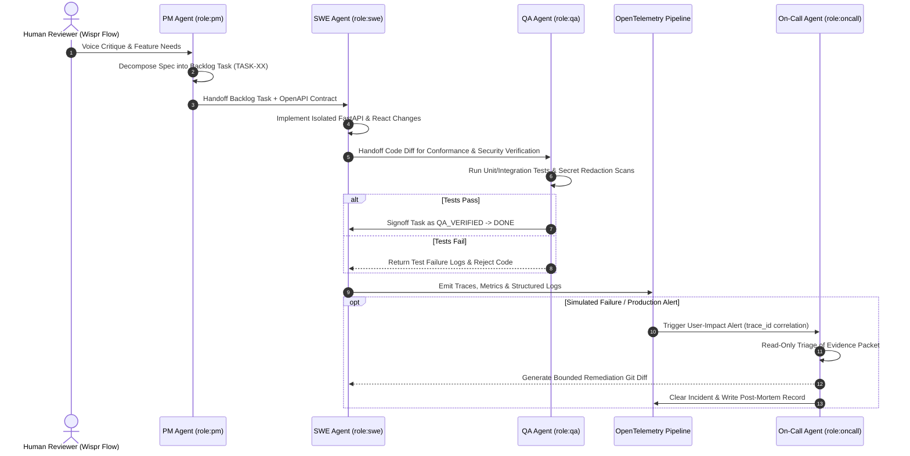

# Agent Team Specification & Handoff Protocols
**DataTalksClub AI Dev Tools Zoomcamp Rubric — Criterion 3 (2/2 Points)**

---

## 1. Multi-Agent Team Architecture

PR-Whisperer is developed, maintained, and operated by a specialized team of 4 autonomous AI agent personas. Rather than relying on a monolithic LLM prompt, responsibility is decomposed across distinct cognitive domains with explicit input/output contracts, bounded permissions, and auditable verification checkpoints.



---

## 2. Specialized Agent Roles & Capabilities

### 2.1 Product Manager Agent (`role:pm`)
- **Mission**: Translate high-level developer workflows and hackathon objectives into unambiguous, testable user stories and deterministic backlog tasks.
- **Artifacts Owned**:
  - [`product-spec.md`](../product-spec.md)
  - Task specifications in [`docs/backlog-tracker.md`](./backlog-tracker.md)
- **Primary Tools**:
  - Markdown authoring, GitHub Issues synchronization (`scripts/sync_github_issues.sh`).
- **Operating Guardrails**:
  - Cannot write backend or frontend code directly.
  - Every task defined must include strict Given/When/Then acceptance criteria and point to a specific user story.

### 2.2 Software Engineer Agent (`role:swe`)
- **Mission**: Implement high-performance, contract-compliant full-stack application code based strictly on `openapi.yaml`.
- **Artifacts Owned**:
  - `backend/app/` (FastAPI routes, SQLAlchemy ORM models, Pydantic schemas, Wispr Flow parsing algorithms)
  - `frontend/src/` (React diff viewer, Wispr Flow audio visualizer, QuerySpeak search drawer)
- **Primary Tools**:
  - Python 3.11, FastAPI, SQLAlchemy 2.0, Vite, Tailwind CSS, Lucide React.
- **Operating Guardrails**:
  - Cannot introduce new API endpoints without updating `openapi.yaml` first.
  - Must implement deterministic offline fallbacks whenever external AI APIs (e.g. Gemini) are referenced.
  - Must ensure zero secret leakage in all log outputs.

### 2.3 QA & Security Engineer Agent (`role:qa`)
- **Mission**: Enforce absolute software quality, test coverage, and security guardrails through automated test pipelines.
- **Artifacts Owned**:
  - `tests/unit/` (Regex security scanners, AST validators, contract drift logic)
  - `tests/integration/` (FastAPI TestClient, SQLite transactions, simulated voice reviews)
  - `.github/workflows/ci-cd.yml` (3-stage automated CI/CD validation and release promotion)
- **Primary Tools**:
  - Pytest, Pytest-Cov, Flake8, Spectral (OpenAPI linter), Docker Compose validator.
- **Operating Guardrails**:
  - Fails any PR or commit where automated tests do not pass 100%.
  - Fails any code change that logs unredacted API keys, passwords, or bearer tokens.
  - Validates that `docs/backlog-tracker.md` execution logs contain verifiable test outputs.

### 2.4 On-Call SRE Responder Agent (`role:oncall`)
- **Mission**: Continuously monitor production health, detect user-impact errors via OpenTelemetry metrics, and perform automated root-cause analysis and remediation.
- **Artifacts Owned**:
  - `incident-response/responder.py`
  - `backend/app/telemetry/`
  - Active incident remediation logs in the database.
- **Primary Tools**:
  - OpenTelemetry Trace API, Prometheus metric scrapers, AST patch synthesizer.
- **Operating Guardrails**:
  - Operates strictly in a **read-only inspection mode** when examining runtime logs and database state.
  - Proposes bounded, human-auditable git diffs for code fixes; never performs untracked database mutations.
  - Generates a mandatory post-mortem record with `trace_id`, error signature, and remediation diff.

---

## 3. Inter-Agent Handoff Protocols

To guarantee seamless state transitions between agents, handoffs must follow a structured schema:

### 3.1 PM -> SWE Handoff Protocol
When a new feature or task is assigned to the SWE agent:
```yaml
handoff_packet:
  from: "role:pm"
  to: "role:swe"
  task_id: "TASK-04"
  user_story_ref: "US-03"
  contract_anchor: "openapi.yaml#/paths/~1api~1v1~1prs~1{pr_id}~1voice-analyze"
  acceptance_criteria:
    - "Detects sk_live_[0-9a-zA-Z]{24} in diff unified chunks"
    - "Flags SQL concatenation in f-strings"
    - "Computes readiness_score deducting 25 pts for critical flaws"
  verification_command: "pytest tests/unit/test_guardrails.py -v"
```

### 3.2 SWE -> QA Handoff Protocol
When code implementation is ready for verification:
```yaml
handoff_packet:
  from: "role:swe"
  to: "role:qa"
  task_id: "TASK-04"
  modified_files:
    - "backend/app/services/guardrails.py"
    - "backend/app/schemas/guardrails.py"
  deterministic_fallback_verified: true
  zero_secret_leak_verified: true
  ready_for_test_execution: true
```

### 3.3 Telemetry -> On-Call Responder Handoff Protocol
When a runtime exception or latency anomaly occurs:
```yaml
incident_packet:
  alert_id: "ALT-20261023-001"
  timestamp: "2026-10-23T10:14:02Z"
  metric_name: "voice_analyze_error_rate"
  current_value: 1.0
  threshold: 0.0
  trace_id: "4bf92f3577b34da6a3ce929d0e0e4736"
  span_name: "post_voice_analyze"
  sanitized_error_message: "Rate limit exceeded or simulated failure flag activated"
  affected_pr_id: "101"
```

---

## 4. Bounded Autonomy & Graph Workflow

The multi-agent workflow operates as a stateful, directed acyclic graph (DAG):

1. **State: SPECIFICATION** -> Handled by PM Agent. Input: User needs -> Output: Updated `product-spec.md` + Backlog item.
2. **State: IMPLEMENTATION** -> Handled by SWE Agent. Input: Contract & Spec -> Output: Python/React diff.
3. **State: VERIFICATION** -> Handled by QA Agent. Input: Code diff -> Output: Pytest execution logs + Pass/Fail flag.
4. **State: INCIDENT_RESPONSE** -> Handled by On-Call Agent. Input: Telemetry alert packet -> Output: Root cause + Suggested remediation patch.

This modular separation prevents cognitive overload, eliminates prompt drift, and ensures complete traceability across the entire lifecycle of PR-Whisperer.
