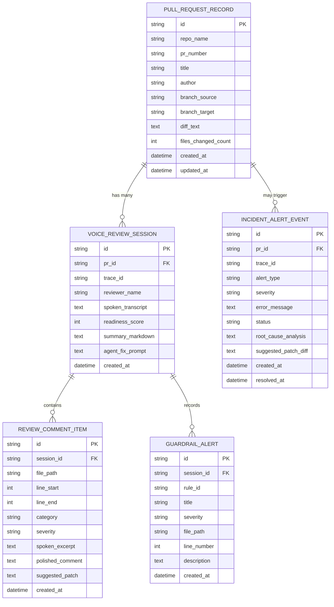

# PR-Whisperer System Architecture & Database Schema
**High-Level Design, Data Pipelines & Relational ER Schema**

---

## 1. High-Level Component Architecture

PR-Whisperer is structured as a decoupled, contract-governed full-stack system designed for local zero-configuration execution and containerized cloud deployment:

```mermaid
graph TB
    subgraph Frontend [React 18 + Vite + Tailwind CSS]
        UI[Review Studio Workspace]
        VoiceBar[Wispr Flow Voice Dictation Bar]
        DiffViewer[Split-Pane Diff & Line Highlighter]
        QuerySpeakBar[QuerySpeak Natural Language Search]
        FixPackModal[1-Click Coding Agent Fix Pack]
        TelemDrawer[Live OpenTelemetry & Incident Drawer]
    end

    subgraph API [FastAPI Service Layer governed by openapi.yaml]
        Router[API v1 Routers /api/v1/*]
        TraceMW[OpenTelemetry Correlation Middleware]
        Scrubber[Secret & PII Scrubber]
        GuardrailEngine[Deterministic AST & Regex Guardrail Scanner]
        DriftEngine[OpenAPI 3.1.0 Contract Drift Analyzer]
        VoiceParser[Wispr Flow Transcript Parser & Synthesizer]
        QueryParser[QuerySpeak Intent & Filter Extractor]
    end

    subgraph Storage [Persistence Layer]
        ORM[SQLAlchemy 2.0 ORM]
        DB[(SQLite Local / PostgreSQL in Compose)]
    end

    subgraph Observability [Telemetry & On-Call System]
        OtelSDK[OpenTelemetry Tracing & Spans]
        Prometheus[Prometheus Metrics Sink]
        IncidentEngine[Incident Simulator & Alert Registry]
        OnCallAgent[Headless On-Call Responder Agent]
    end

    subgraph External [External Integrations]
        WisprApp[Wispr Flow Desktop Dictation Engine]
        MCP[Model Context Protocol Server :8001]
        CodingAgents[Claude Code / Cursor / Antigravity]
    end

    VoiceBar -.->|Direct Voice Input| WisprApp
    VoiceBar -->|POST /api/v1/prs/{id}/voice-analyze| Router
    QuerySpeakBar -->|POST /api/v1/queryspeak| Router
    UI -->|GET /api/v1/prs| Router
    Router --> TraceMW
    TraceMW --> Scrubber
    Router --> GuardrailEngine
    Router --> DriftEngine
    Router --> VoiceParser
    Router --> QueryParser
    VoiceParser --> ORM
    GuardrailEngine --> ORM
    ORM --> DB
    TraceMW --> OtelSDK
    Router --> Prometheus
    IncidentEngine --> OnCallAgent
    OnCallAgent --> OtelSDK
    FixPackModal --> CodingAgents
    ORM --> MCP
    MCP --> CodingAgents
```

---

## 2. Relational Database Entity-Relationship (ER) Schema

The persistence layer uses SQLAlchemy 2.0 with complete relational integrity, cascading deletions, and indexed query paths:



### Table Definitions & Design Decisions:
1. **`pull_request_records`**:
   - Stores git diff metadata, author, branches, and raw unified diff text.
   - Pre-seeded with 3 realistic scenarios (`PR-101`, `PR-102`, `PR-103`).
2. **`voice_review_sessions`**:
   - Encapsulates each voice review run. Contains the raw transcript from Wispr Flow, the synthesized high-level review summary, calculated `readiness_score` (0-100), and the unified Coding Agent Fix Prompt.
   - Tied to `trace_id` for end-to-end telemetry correlation.
3. **`review_comment_items`**:
   - Represents discrete, file/line-pinned review feedback cards.
   - Stores both what the reviewer spoke (`spoken_excerpt`) and the constructive GitHub phrasing (`polished_comment`), alongside a unified git replacement diff (`suggested_patch`).
4. **`guardrail_alerts`**:
   - Deterministic violations detected by AST/regex scanners (e.g. `SEC-001`, `SEC-002`, `DRIFT-001`).
5. **`incident_alert_events`**:
   - Tracks operational anomalies and user-impact errors. Used by the On-Call Responder Agent to log diagnostics, root cause analysis, and proposed remediation diffs.

---

## 3. Data Processing Pipelines

### 3.1 Voice Analysis Pipeline
1. **Ingestion**: Reviewer speaks via Wispr Flow into the frontend review bar.
2. **Contract Validation**: Request validated against `POST /api/v1/prs/{pr_id}/voice-analyze` in `openapi.yaml`.
3. **Telemetry Span Creation**: Generates OpenTelemetry span and injects `trace_id`.
4. **Deterministic Security Scan**:
   - Regex scan: Matches Stripe/AWS/GitHub API keys, private keys, bearer tokens.
   - Python AST visitor: Inspects f-string SQL queries and unescaped database executions.
5. **OpenAPI Contract Drift Scan**:
   - Compares added/modified HTTP paths, query parameters, and JSON payloads against `openapi.yaml`.
6. **Transcript Parsing & Review Card Synthesis**:
   - Extracts file locations and line references from natural speech.
   - Polishes colloquial voice remarks into polite, actionable GitHub comments.
   - Generates unified diff patch proposals.
7. **Readiness Score Computation**:
   - Base = 100. Deductions: Critical (-25), Warning (-10), Suggestion (-3).
8. **Persistence & Return**:
   - Atomically saves session, comments, and alerts within a single database transaction.

### 3.2 QuerySpeak Voice Audit Pipeline
1. **Audio/Text Input**: Reviewer dictates search query (e.g., *"Show critical security issues in payment PRs"*).
2. **Entity & Intent Extraction**:
   - Severity: `Critical`
   - Category: `Security`
   - Target Scope: `payment`
3. **Dynamic Query Generation**:
   - Executes parameterized SQLAlchemy queries against `review_comment_items` and `pull_request_records`.
4. **Synthesis**:
   - Formulates aggregated statistics and an executive insight summary.

---

## 4. Model Context Protocol (MCP) Server Architecture

PR-Whisperer exposes a lightweight MCP server (`mcp-server/server.py`) conforming to the official Model Context Protocol standard:
- **Exposed Resource**: `pr://{pr_id}/review-context`
  - Returns unified diff, active review cards, guardrail findings, and readiness score.
- **Exposed Tool**: `get_pr_fix_context(pr_id: str)`
  - Returns structured JSON for coding agents (Claude Code, Cursor, Antigravity) to automatically checkout files and apply suggested patches.
