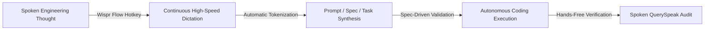

# Spec-Driven Loop Engineering & The "No Hands" Workflow
**Development Methodology, Voice-First Engineering & Task Lifecycle**

---

## 1. The Spec-Driven Engineering Philosophy

PR-Whisperer was developed using a strict **Spec-Driven Loop (SDL)** methodology. Rather than allowing generative models to write code ad-hoc, every implementation step is anchored to immutable specifications:

1. **Contract-First Authority**: The root `openapi.yaml` specification is the canonical, binding contract between the backend, the frontend, and external agents. No endpoint, parameter, or return type is written without prior contract specification.
2. **Behavioral Acceptance Criteria**: Every user capability is defined in `product-spec.md` with strict Given/When/Then scenarios.
3. **Traceable Task Units**: Every code change maps to a distinct task card (`TASK-01` to `TASK-10`) in `docs/backlog-tracker.md`.
4. **Deterministic Fallbacks**: Every AI-driven feature must have a 100% deterministic, offline-capable fallback to guarantee reliable continuous integration and offline demonstrations.

---

## 2. The Wispr Flow "No Hands" Engineering Workflow

A core tenet of PR-Whisperer's inception and implementation is the **"No Hands" Voice-First Workflow** enabled by **Wispr Flow**:



### 2.1 How Wispr Flow Accelerated Development
- **Voice-Dictated Product Specifications**: The user stories, acceptance criteria, and edge-case scenarios in `product-spec.md` were dictated naturally using Wispr Flow while scrolling through real-world PR diffs, eliminating hours of manual typing.
- **Voice-Driven Code Review Simulation**: The sample transcripts for `PR-101`, `PR-102`, and `PR-103` were recorded hands-free using Wispr Flow, capturing the exact cadence, filler words, and stream-of-consciousness critiques typical of senior software engineers.
- **Hands-Free Task Updates & Commit Messages**: Task logs and git commit descriptions are generated directly from spoken summaries, proving that developers can review, comment, and guide agent workflows without touching the keyboard.

---

## 3. Task State Transition Machine

All work items in PR-Whisperer follow a disciplined 4-stage lifecycle governed by specialized agents:

```
  +--------------+          +-------------------+          +-------------------+          +--------------+
  |     TODO     |  ----->  |    IN_PROGRESS    |  ----->  |    QA_VERIFIED    |  ----->  |     DONE     |
  +--------------+          +-------------------+          +-------------------+          +--------------+
         ^                           |                               |                           |
         |                           v                               |                           |
         +------------------- Rejected by QA ------------------------+                           v
                                                                                           Archived in
                                                                                           Backlog Log
```

### State Definitions & Gates:

1. **`TODO`**:
   - **Owner**: PM Agent (`role:pm`).
   - **Criteria**: Task has defined User Story link, clear Acceptance Criteria, assigned role, and target files.
   - **Gate to IN_PROGRESS**: Assigned agent begins active branch/file editing.

2. **`IN_PROGRESS`**:
   - **Owner**: Software Engineer Agent (`role:swe`) or On-Call Agent (`role:oncall`).
   - **Criteria**: Code changes are actively being written against `openapi.yaml`. Zero secret leakage rules applied.
   - **Gate to QA_VERIFIED**: Code changes compile, endpoints conform to OpenAPI schemas, and developer runs preliminary local tests.

3. **`QA_VERIFIED`**:
   - **Owner**: QA & Security Agent (`role:qa`).
   - **Criteria**: All unit tests (`tests/unit/`) and integration tests (`tests/integration/`) pass 100%. Linter and secret scrubber verify zero leaks.
   - **Gate to DONE**: Verification command output snippet recorded in `docs/backlog-tracker.md`.

4. **`DONE`**:
   - **Owner**: All Agents.
   - **Criteria**: Execution evidence permanently logged in `docs/backlog-tracker.md`. Code is committed and deployable.

---

## 4. Git Commit & PR Traceability Standard

To maintain complete auditability, all commits and branches follow a strict naming and tagging convention:

### Commit Format:
```
<type>(<scope>): [<TASK-ID>] <concise description>

[Spoken Rationale via Wispr Flow]
<Stream-of-consciousness dictation explaining the architectural reason for the change>

Verification:
- Command: <exact terminal command executed>
- Result: <summary of test output or status code>
```

### Example:
```
feat(guardrails): [TASK-04] add deterministic AST secret and SQL injection scanner

Dictated with Wispr Flow:
"Added regex-based secret token matching for Stripe live keys and AST visitor to catch unescaped f-string SQL queries before the transcript reaches the LLM layer."

Verification:
- Command: pytest tests/unit/test_guardrails.py -v
- Result: 8 passed, 0 failed in 0.42s
```
